# TryHackMe: PHP2Shell

Write-up de la sala [PHP2Shell](https://tryhackme.com/room/cvephp2shell), que recorre las tareas de comprensión de `session.upload_progress`, la validación del contexto de ejecución y las recomendaciones de mitigación indicadas por el laboratorio.

> **Alcance:** las pruebas descritas se realizaron únicamente contra la máquina asignada por TryHackMe. La IP cambia entre sesiones. Las capturas son evidencia del laboratorio; los comandos y la flag se omiten del texto.

## Resumen

| Fase | Resultado |
|---|---|
| Preparación | Máquina iniciada, perfil de conexión descargado y VPN conectada. |
| Reconocimiento | Se comprobó conectividad con la IP del laboratorio y se identificó SSH en el puerto 22. |
| Contexto de laboratorio | TryHackMe entrega acceso SSH; desde esa sesión se localiza el proyecto y se estudia el servicio HTTP de prueba enlazado a `127.0.0.1:8088`. |
| Validación | La demostración del laboratorio confirma ejecución de comandos como `www-data`, usuario del servicio web. |
| Resultado | Se completa la sala y se valida la flag en TryHackMe. Las evidencias no demuestran una escalada a `root`. |

## Procedimiento y evidencias

### 1. Preparar el entorno

Se inicia la máquina desde la sala y se conecta el entorno de trabajo a la VPN de TryHackMe. La dirección de la máquina es temporal y debe consultarse de nuevo en cada sesión. La sala también proporciona credenciales de laboratorio para el acceso SSH.

**Inicio de la máquina en TryHackMe**

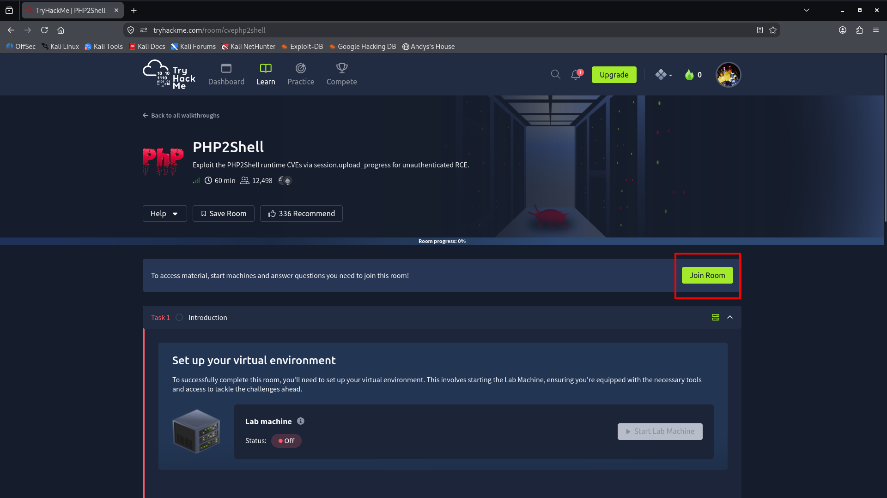
*El recuadro rojo señala el botón para unirse a la sala; es una referencia visual de la interfaz.*

**Máquina iniciada y métodos de conexión**

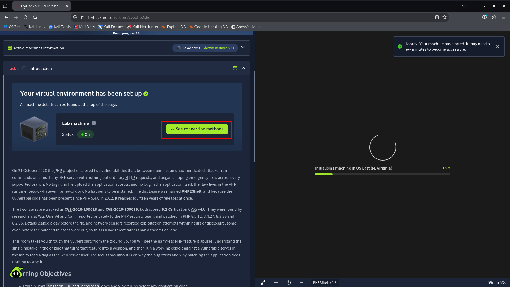
*El recuadro rojo destaca dónde consultar los métodos de conexión.*

**Acceso y descarga de la configuración VPN**

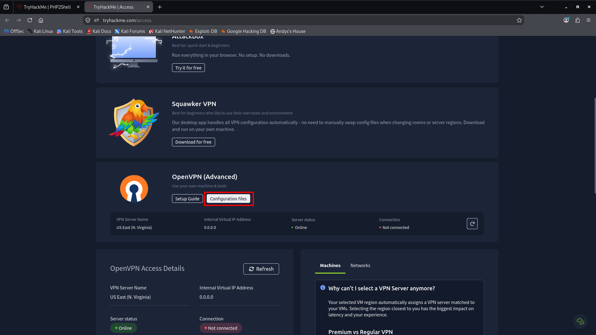
*Se indica la opción para abrir los archivos de configuración de OpenVPN.*

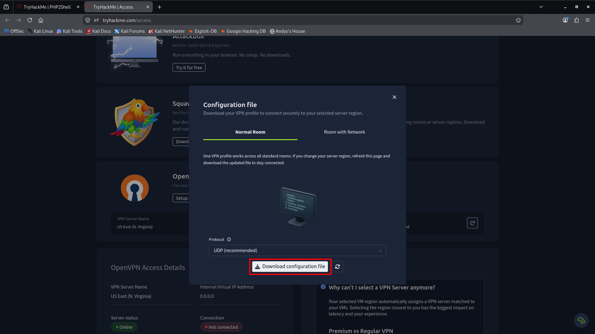
*El recuadro marca el botón de descarga del perfil VPN; no se incluye aquí el archivo de configuración.*

**Conexión a la VPN**

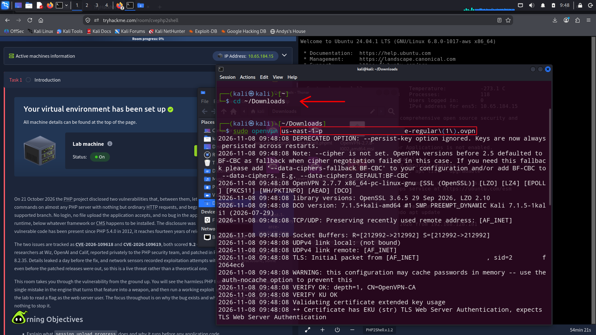
*La flecha y el recuadro identifican el perfil seleccionado para iniciar la conexión.*

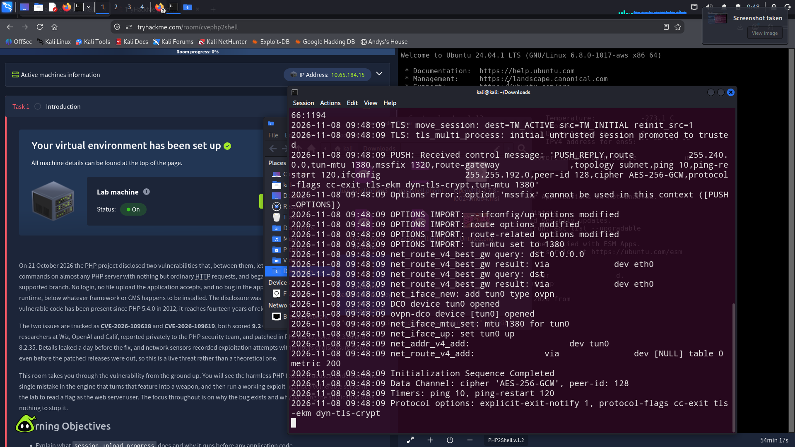
*Captura referencial del establecimiento de la conexión y de la salida informativa del cliente VPN.*

### 2. Reconocimiento y acceso al sistema

Se comprueba que la máquina de laboratorio responde y se identifica SSH como servicio accesible. TryHackMe proporciona credenciales para entrar por SSH. La sala indica que el servicio HTTP de práctica escucha en `127.0.0.1:8088` dentro de la máquina: no es un puerto HTTP expuesto directamente a la máquina de ataque, y la demostración se realiza desde el contexto de laboratorio autorizado.

**Credenciales de acceso del laboratorio**

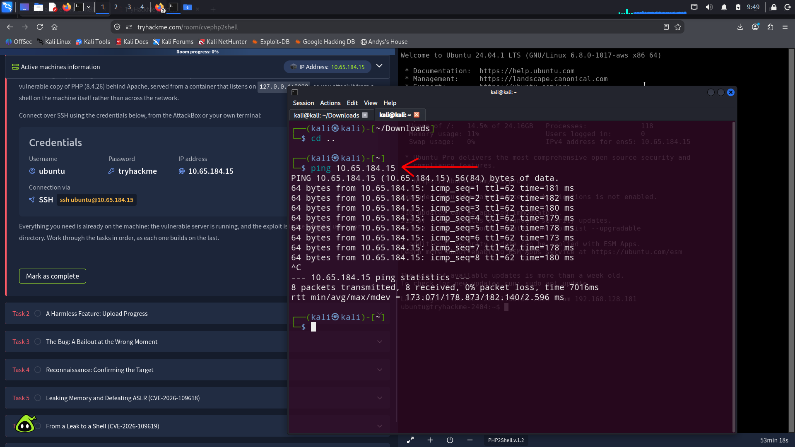
*La captura muestra los datos de acceso que entrega la sala; son propios del laboratorio y deben tratarse como temporales.*

**Reconocimiento de SSH y conexión al host**

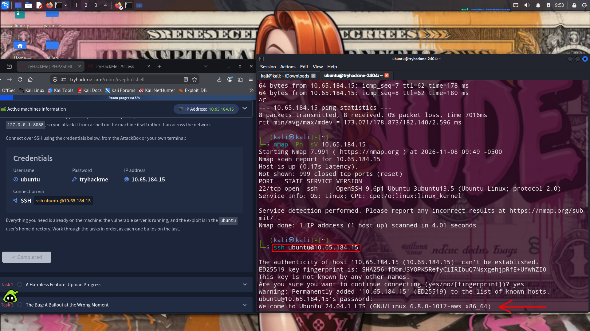
*El recuadro y la flecha resaltan el comando de conexión SSH y el resultado del reconocimiento del servicio.*

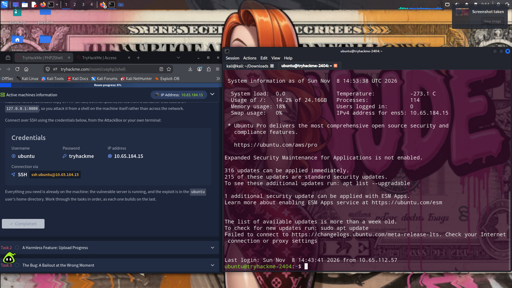
*Se confirma que la sesión remota quedó establecida; los datos de red de la pantalla corresponden al entorno de laboratorio.*

La IP y las credenciales visibles pertenecen al entorno temporal de TryHackMe; no se deben reutilizar fuera de la sala.

### 3. Enumeración del entorno

Primero se inspecciona el sistema y se identifica el directorio del proyecto PHP2Shell:

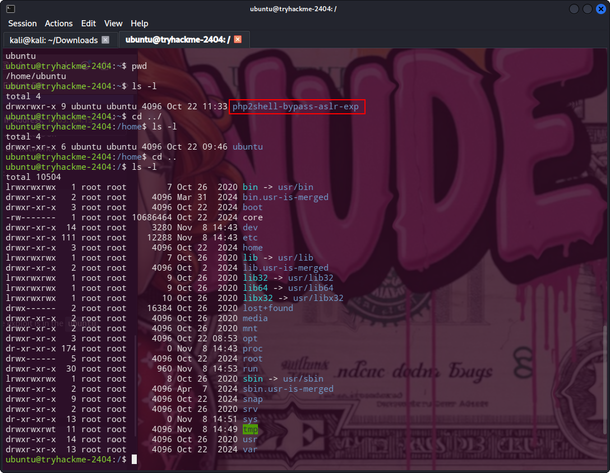
*El recuadro señala el directorio del laboratorio encontrado durante la inspección.*

Luego se entra al directorio del proyecto y se revisan sus archivos:

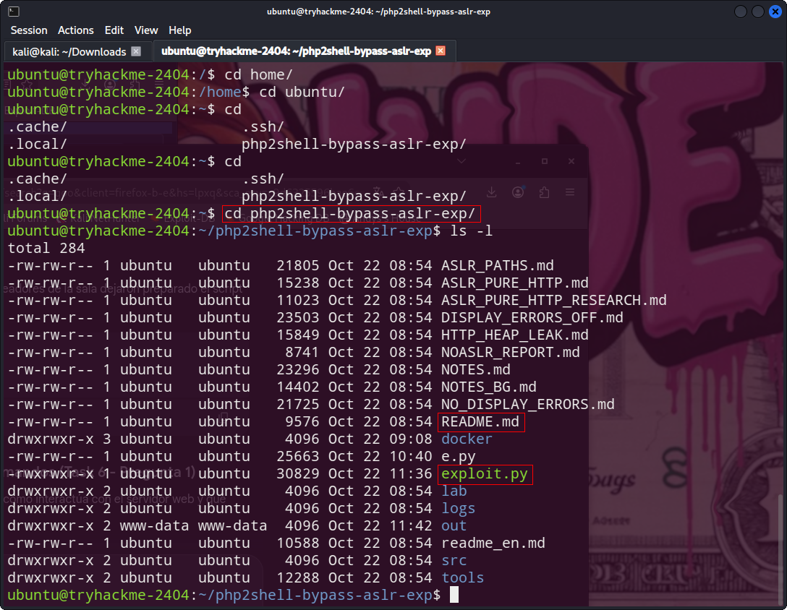
*Se destacan el README, los archivos de apoyo y el exploit del laboratorio.*

Al consultar el README del proyecto se encuentran explicaciones y referencias que ayudan a comprender la demostración. Ese material se utilizó como fuente de consulta y no se presenta como código original del autor de este write-up.

**README de referencia del proyecto**

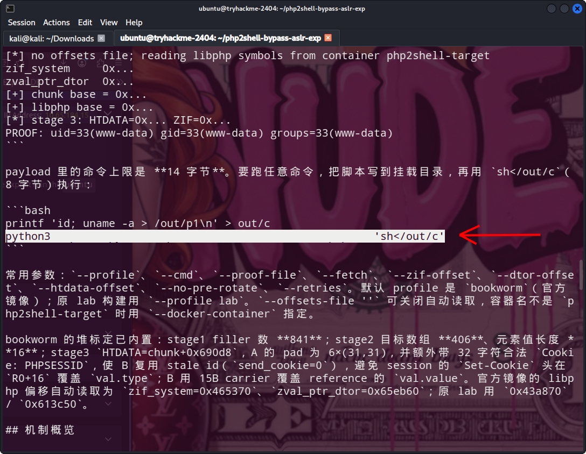
*La captura muestra la documentación consultada para comprender la demostración; el material del proyecto se cita como referencia y no como código propio.*

### 4. Hallazgo y validación del acceso

La sala presenta dos vulnerabilidades del runtime PHP vinculadas a `session.upload_progress`: CVE-2026-109618, asociada a una filtración de memoria que ayuda a sortear ASLR, y CVE-2026-109619, que completa la cadena hasta la ejecución de comandos. El fallo reside en el runtime y en el tratamiento de solicitudes multipart, no necesariamente en el código de la aplicación o del CMS que utiliza PHP.

La demostración valida ejecución con la identidad `www-data`. **`www-data` no es una extensión:** es una cuenta de servicio del sistema que suele utilizar el servidor web; los procesos PHP pueden ejecutarse con esos permisos. No equivale a obtener `root`.

**Evidencia del contexto de ejecución**

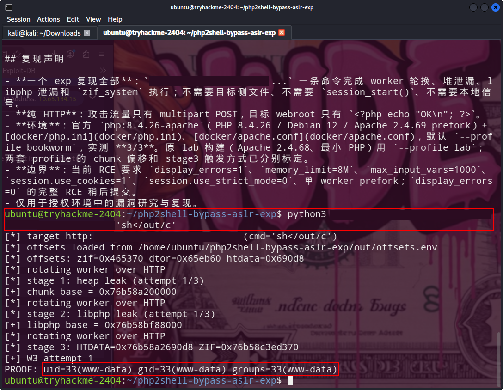
*La salida resaltada confirma el usuario y grupo efectivos del proceso. La flag está cubierta; la imagen también conserva partes de la demostración técnica.*

La sala distingue entre confirmar el contexto de ejecución del servicio web y recuperar la flag mediante una solicitud adaptada; aquí se documenta el resultado sin reproducir el procedimiento.

El avance de la sala depende principalmente de comprender y relacionar la información que se presenta en sus tareas. El recorrido cubre:

1. **Introducción:** contexto de las vulnerabilidades y preparación del entorno.
2. **Una función aparentemente inocua:** qué hace `session.upload_progress`.
3. **El fallo:** cómo el comportamiento del runtime convierte esa función en un riesgo.
4. **Reconocimiento:** confirmar el objetivo y el contexto del servicio de laboratorio.
5. **Filtración de memoria y ASLR:** comprender el primer CVE y el papel de la aleatorización.
6. **De la filtración a la ejecución:** observar el impacto encadenado y validar el contexto `www-data`.
7. **Detección, mitigación y corrección:** identificar las medidas defensivas y la solución mediante actualización.
8. **Conclusión:** repasar el impacto y las lecciones del laboratorio.

La mayoría de las preguntas se responden leyendo con atención el contenido de cada tarea. La flag es la excepción: debe obtenerse y validarse en la máquina del laboratorio. La salida como `www-data` demuestra el contexto del proceso web, mientras que recuperar la flag es un paso distinto que requiere adaptar la solicitud de prueba. Se omiten los detalles ejecutables de esa modificación.

**Límite del resultado:** obtener ejecución como `www-data` no equivale a ser `root`. En las evidencias disponibles no se demuestra una escalada de privilegios; por tanto, el write-up no la presenta como parte de la solución.

**Sala completada**

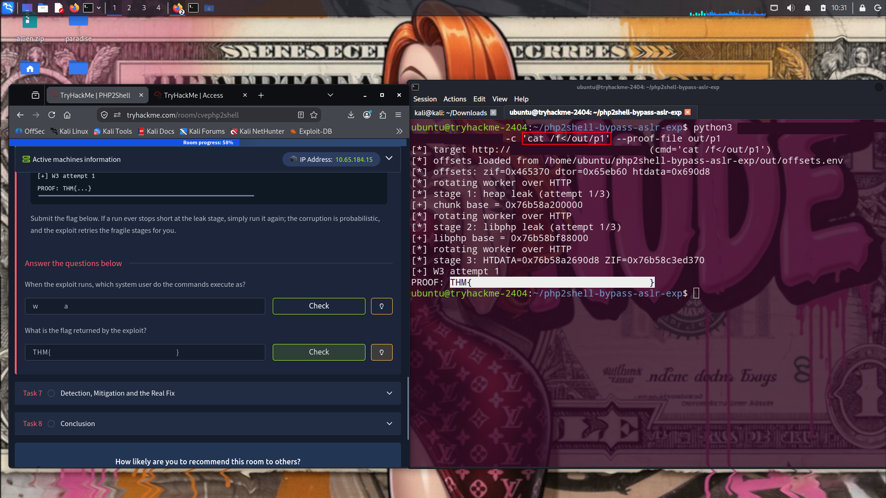
*La evidencia muestra la respuesta validada en la tarea; el valor de la flag está oculto.*

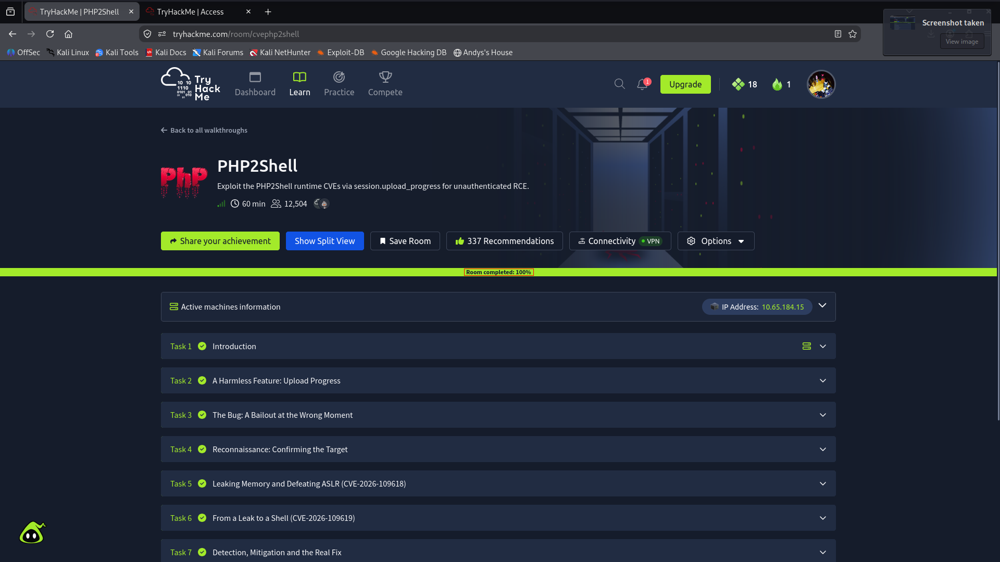
*La captura final muestra el progreso de la sala al 100 % y las tareas completadas.*

## Causa e impacto

El caso ilustra el riesgo de un fallo de memoria en una función del runtime que procesa solicitudes antes de que la lógica de la aplicación pueda intervenir. En el entorno de la sala, la cadena permite alcanzar ejecución de comandos como el usuario del proceso PHP sin autenticación de aplicación, pero la interfaz HTTP de práctica está enlazada a localhost. El impacto en un despliegue real dependería de la exposición del servicio, los permisos de PHP y los datos accesibles para esa cuenta.

## Recomendaciones

1. **Actualizar PHP:** instalar una versión corregida y mantenida de la rama desplegada. La introducción de la sala menciona las versiones corregidas 8.5.12, 8.4.27, 8.3.36 y 8.2.35; confirmar siempre los avisos oficiales vigentes antes de actualizar. Actualizar también imágenes base y dependencias, reconstruir los contenedores y reiniciar los procesos para activar el runtime parcheado.
2. **Reducir la exposición:** deshabilitar `session.upload_progress` si la aplicación no lo necesita. Esto es una medida de reducción de superficie, no sustituye la actualización del runtime.
3. **Aislar servicios:** mantener los servicios internos enlazados a interfaces locales cuando sea apropiado, limitar el acceso mediante reglas de red y evitar que contenedores o servicios de administración queden expuestos innecesariamente.
4. **Aplicar mínimo privilegio:** ejecutar PHP con una cuenta sin privilegios, restringir permisos de lectura y escritura, separar secretos del directorio web y limitar el acceso del proceso a recursos del sistema.
5. **Añadir defensa en profundidad:** usar aislamiento de contenedores y controles de egreso; un WAF puede ayudar a detectar o filtrar solicitudes anómalas, pero no corrige el defecto del runtime.
6. **Detectar y responder:** vigilar solicitudes multipart inusuales, errores o reinicios del proceso PHP y procesos hijos inesperados. Si se sospecha explotación, tratar el host como comprometido, rotar los secretos accesibles y reconstruirlo desde una imagen confiable después de corregir la causa.

## Nota sobre las evidencias

Las capturas son de una máquina de laboratorio y algunas muestran IP temporales, credenciales entregadas por TryHackMe, información del equipo local o comandos y parámetros del reto. La captura 12 se mantiene fuera del README porque incluye detalles operativos de explotación. Antes de publicar, revisa las imágenes por si contienen flags, credenciales personales, tokens VPN, nombres de usuario o datos de red que no quieras divulgar. Las credenciales temporales de la sala no deben reutilizarse fuera del laboratorio.

---

## Autoría

**Patricio Allendes** · [PatoLock](https://github.com/patolock)  
*Estudiante de Ciberseguridad · Pentester Trainee*

> *Documentar para aprender; aprender para proteger.*
